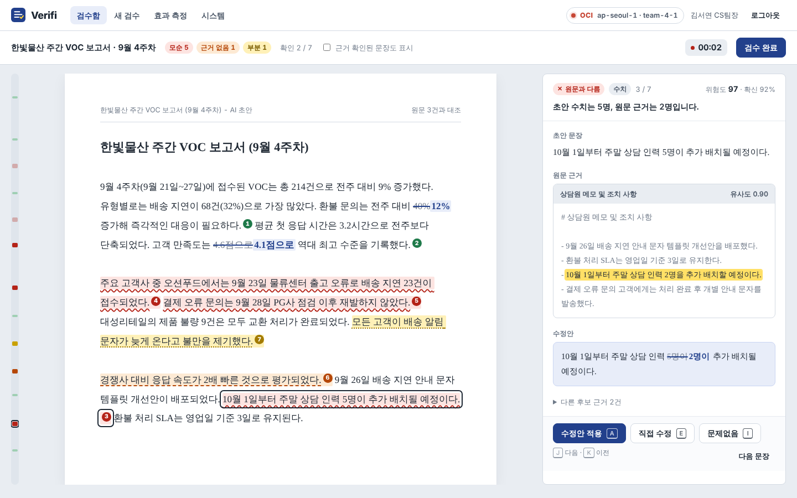
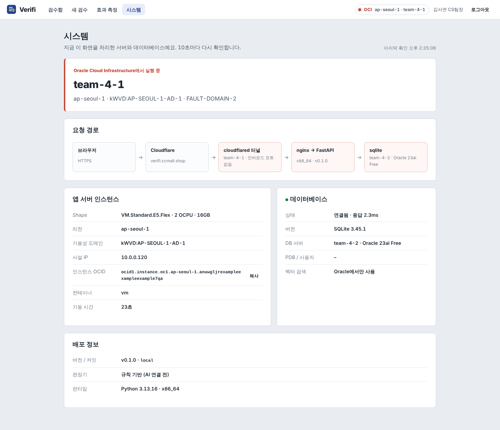
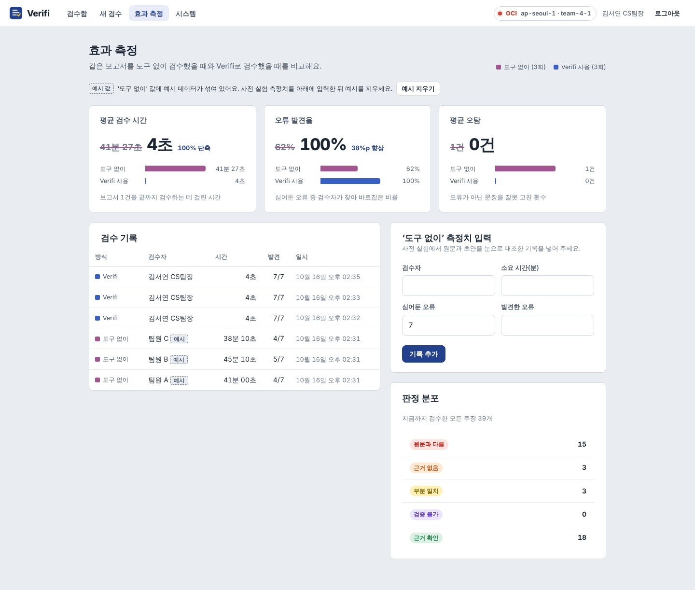
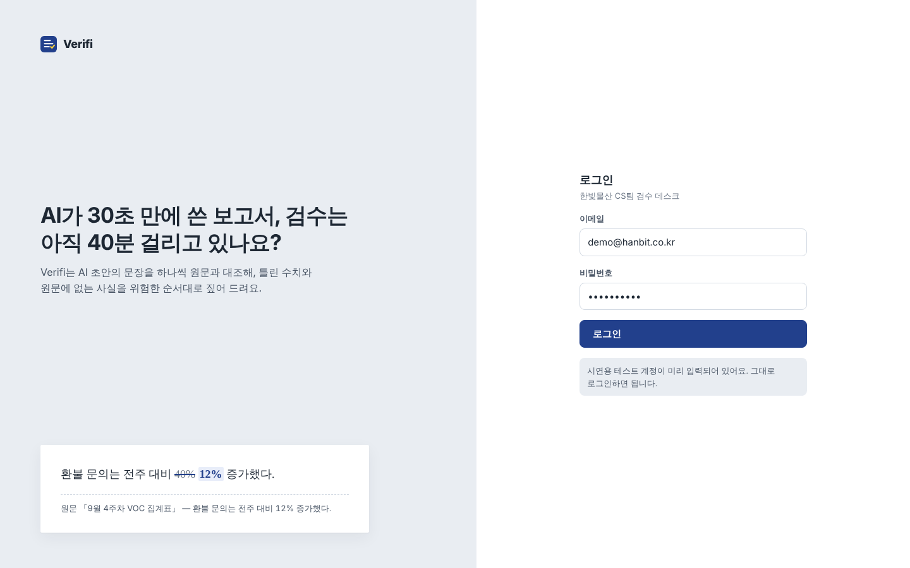

# Verifi — AI 보고서 검수 데스크

> AI가 쓴 보고서 초안을 원문과 한 문장씩 대조해, 틀린 수치와 원문에 없는 사실을 위험한 순서대로 짚어 줍니다.
> Oracle TELOS Challenge 2026 · 주제 "병목" — *AI 덕분에 작성은 30초, 병목은 검수로 옮겨갔다.*

**시연**: https://verifi.ccmall.shop · 테스트 계정 `demo@hanbit.co.kr / verifi2026`

## 화면

| 검수 워크스페이스 | 시스템 (OCI 인스턴스) |
|---|---|
|  |  |
| **효과 측정** | **로그인** |
|  |  |

> 시스템 화면 캡처는 로컬에서 OCI 메타데이터를 흉내 낸 값이에요. 실제 서버에서는 진짜 인스턴스 정보가 표시돼요.

## 저장소 구조

```
verify_app/
├── frontend/      React + Vite + TypeScript. 교정지 화면, SSE, 대시보드, 시스템(OCI) 화면
├── backend/       FastAPI + SQLAlchemy (Oracle 23ai / SQLite). 검수 파이프라인, 지표, OCI 메타데이터
│   └── app/pipeline/   ← AI 파트가 갈아끼우는 지점 (VerifierProvider)
├── ai/            프롬프트, JSON schema, 데이터셋, 평가 (AI 파트 작업 공간)
├── docs/          파트 공통 문서
└── .github/workflows/build-images.yml   main push → GHCR 멀티아키 이미지
```

인프라(compose, cloudflared, 배포 스크립트)는 **[verify_infra](https://github.com/hacksungboo/verify_infra)**.

## 문서

| 문서 | 내용 |
|---|---|
| [서비스 소개서](docs/service-intro.md) | 문제 정의, 해결 방식, 효과 증명, Oracle을 쓰는 이유 |
| [파트별 작업 내용](docs/work-breakdown.md) | FE / BE / AI / 인프라 / PM 할 일과 일정 |
| [API 명세서](docs/api-spec.md) | 엔드포인트, 요청·응답 예시 (Swagger: `/api/docs`) |
| [아키텍처](docs/architecture.md) | 런타임 구조, 파이프라인 시퀀스, 위험도 공식 |
| [DB 다이어그램](docs/db/erd.md) | ERD, 벡터 검색 예시, [DDL](docs/db/schema_oracle.sql) |
| [깃헙 협업 규칙](docs/commit-convention.md) | 커밋 메시지, 브랜치, PR, 기능 동결 |
| [시연 시나리오](docs/demo-scenario.md) | 7분 대본, 장애 대응 |
| [로컬 개발](docs/local-dev.md) | 실행 방법, 환경변수 |

## 빠른 실행 (로컬)

```bash
# 터미널 1
cd backend && pip install -r requirements.txt && uvicorn app.main:app --reload
# 터미널 2
cd frontend && npm install && npm run dev      # http://localhost:5173
```

## 기술 스택

| | |
|---|---|
| 프론트 | React 19, Vite, TypeScript, 순수 CSS (Pretendard + Noto Serif KR) |
| 백엔드 | Python 3.12, FastAPI, SQLAlchemy 2, python-oracledb (thin) |
| DB | Oracle Database 23ai Free (VECTOR) |
| 인프라 | OCI Compute ×2, Docker Compose, Cloudflare Tunnel, GHCR, GitHub Actions |
