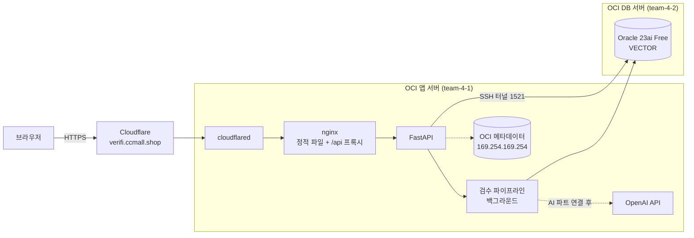
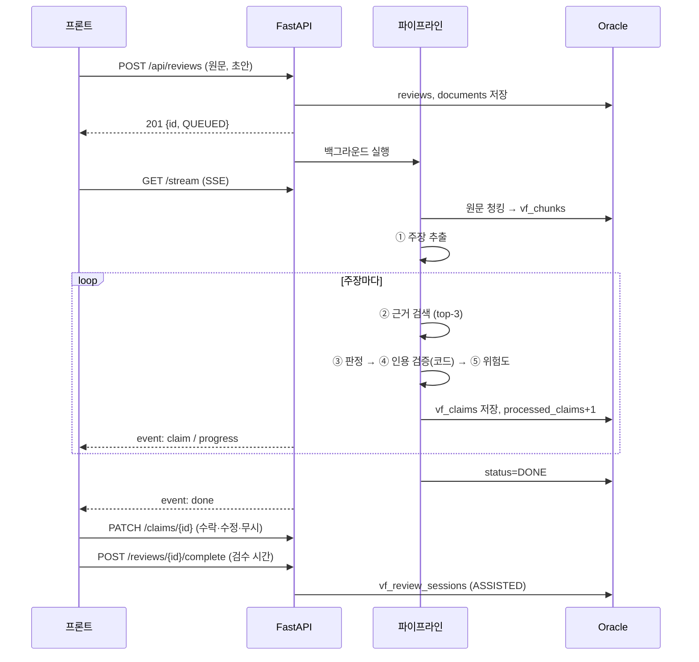

# 아키텍처

## 런타임



## 검수 파이프라인



## 파이프라인 교체 지점

```
backend/app/pipeline/
├── base.py            VerifierProvider 인터페이스 (extract_claims / retrieve / judge)
├── rule_based.py      규칙 기반 구현 (지금 동작 중, AI 연결 후엔 숫자·날짜 교차검증용)
├── openai_provider.py AI 파트 구현 자리 (AI_PROVIDER=openai)
├── runner.py          DB 저장 · 진행률 · 인용 검증 · 위험도 — 구현체와 무관하게 공통
└── textutil.py        문장 분리, 수치·날짜·고유명사 추출
```

구현체는 순수 로직만. DB, 진행률, 인용 검증, 위험도는 `runner.py`가 맡아요.

## 위험도

```
risk = 판정 심각도 × 유형 가중치 × 확신 보정 × 100
  심각도: 원문과 다름 1.0 · 근거 없음 0.8 · 검증 불가 0.65 · 부분 0.5 · 확인 0.05
  유형:   수치 1.0 · 날짜 0.95 · 고유명사 0.9 · 일반화 0.75 · 서술 0.6
  확신 보정: 문제 판정은 0.6 + 0.4×confidence (확신할수록 위험), 확인 판정은 1 + (1−confidence)
```

## 설계 결정

| 결정 | 이유 |
|---|---|
| Redis·별도 워커 없이 FastAPI 백그라운드 | 1박 2일. 진행 상태는 DB에 있어 SSE가 DB를 읽으면 충분 |
| SSE + 폴링 폴백 | Cloudflare 경유 시 끊겨도 시연이 멈추지 않게 |
| SQLAlchemy로 Oracle/SQLite 겸용 | 로컬은 DB 없이 개발, 서버는 Oracle |
| 해시 라우터, 외부 UI 라이브러리 없음 | 의존성 최소화, nginx 설정 단순 |
| cloudflared, SSH 터널, GHCR | OCI 콘솔 권한 없이 배포 가능 |
