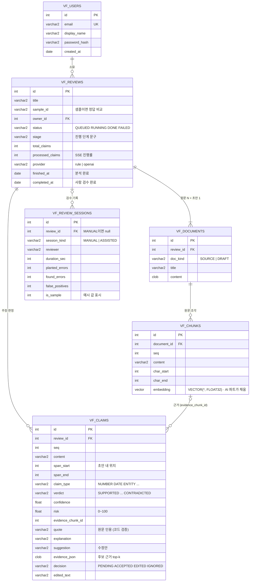

# DB 다이어그램 (Oracle Database 23ai)

테이블은 모두 `vf_` 접두사. 앱이 기동할 때 없으면 자동으로 만들어요 (`backend/app/models.py`). 실제 DDL은 [schema_oracle.sql](./schema_oracle.sql).



## 메모

- **Oracle 예약어를 피했어요**: `MODE`, `LEVEL`, `SIZE`, `COMMENT`, `TYPE` 대신 `session_kind`, `claim_type`, `doc_kind`
- 문자열 컬럼은 `VARCHAR2(n CHAR)`지만 Oracle 기본 최대 4000바이트라, 한글은 약 1300자. 앱에서 조각 1200자, 주장·인용 600자로 자름
- JSON은 `CLOB`에 문자열로 저장 (SQLite 겸용). Oracle 전용으로 가면 `JSON` 타입으로 바꿔도 됨

## AI 파트용: 벡터 검색 예시

```sql
-- 임베딩 저장
UPDATE vf_chunks SET embedding = TO_VECTOR(:vec_json) WHERE id = :id;

-- 주장과 가장 가까운 원문 조각 5개 (같은 검수 건 안에서)
SELECT c.id, c.content, VECTOR_DISTANCE(c.embedding, TO_VECTOR(:claim_vec), COSINE) AS dist
  FROM vf_chunks c JOIN vf_documents d ON d.id = c.document_id
 WHERE d.review_id = :review_id
 ORDER BY dist
 FETCH FIRST 5 ROWS ONLY;
```

python-oracledb에서는 `array.array("f", embedding)` 을 바인드하면 `TO_VECTOR` 없이도 들어가요.
